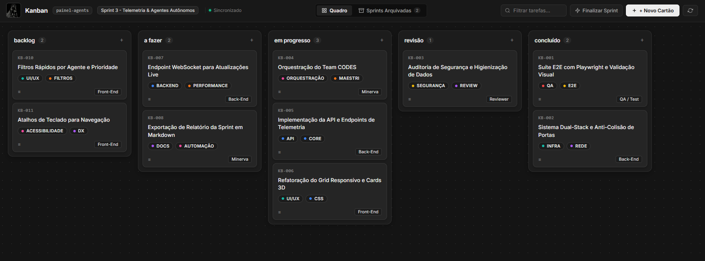
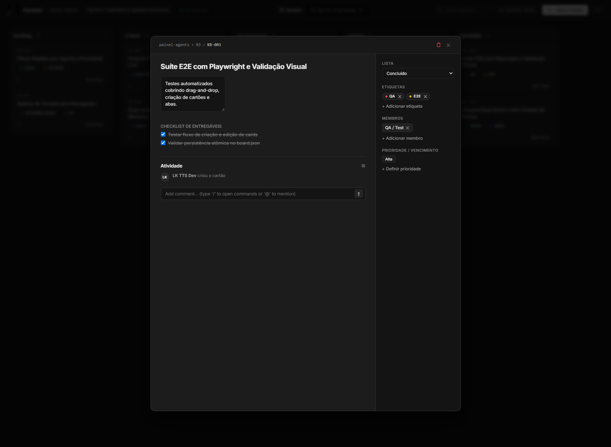

<div align="center">


# kanban-agents

**Quadro ágil minimalista, nativo, ultraleve e isolado por projeto estilo kan.bn para o Maestri Spatial Development Workspace.**

**[Português](README.md)** | **[English](README.en.md)**

[](LICENSE)
[](https://www.python.org/)
[](#início-rápido)
[](#destaques)
[](#destaques)
[](#destaques)

</div>

---

## Apresentação Visual

### Quadro Principal (Estilo kan.bn Dark)
Visualização limpa das colunas ágeis (`Backlog`, `A Fazer`, `Em Progresso`, `Revisão`, `Concluído`), cartões com etiquetas coloridas, identificador de agente responsável e controle de sprints no topo.

<p align="center">
  
</p>

### Detalhes da Tarefa & Modal de Criação Rápida
Ao clicar em qualquer cartão, um modal de duas colunas exibe descrição editável, checklist com progresso, histórico de atividades, comentários e propriedades laterais. O modal de criação permite cadastrar múltiplas tarefas em sequência com o seletor **Criar outro**.

<p align="center">
  
</p>

<p align="center">
  
</p>

---

## O que é

`kanban-agents` é um gestor de tarefas visual minimalista e funcional, projetado especificamente para operar como um nó de **Portal** integrado no **Maestri Canvas** ou diretamente em uma **janela dedicada no monitor secundário** para demandas individuais e acompanhamento do time de agentes.

Inspirado na estética refinada do **kan.bn**, o `kanban-agents` roda com um servidor nativo ultraleve em Python (< 20 MB de RAM), salvando o estado de forma atômica e versionável diretamente no arquivo **`.kanban/board.json`** na raiz do seu projeto ativo, sem containers pesados, sem banco de dados externo e sem menus corporativos desnecessários.

```text
┌────────────────────────────────────────────────────────────────────────┐
│                            MAESTRI CANVAS                              │
│                                                                        │
│   [ Terminal 1: Minerva    ] ──┐                                       │
│   [ Terminal 2: Team CODES ] ──┼── (Leitura & Escrita Atômica) ──┐     │
│   [ Terminal 3: Agy        ] ──┘                                 │     │
│                                                                  ▼     │
│   [ Workspace Ativo        ] ─────── [.kanban/board.json] ───────┤     │
│                                                                  │     │
│   [ Portal / Monitor Ext   ] <────── http://127.0.0.1:3334 ──────┘     │
│     ├── Colunas Ágeis (Backlog, A Fazer, Em Progresso, Revisão, Feito) │
│     ├── Modal de Criação Rápida ("Criar outro" em lote contínuo)       │
│     ├── Visualização Completa (Breadcrumbs, Checklists, Logs & Tags)   │
│     └── Ciclos de Sprint & Arquivamento Automático em 1 Clique         │
└────────────────────────────────────────────────────────────────────────┘
```

---

## Destaques

- **Design Minimalista Preto & Cinza (Estilo kan.bn)**:
  - Paleta em tons estritamente neutros e alto contraste: Canvas em `#141414`, colunas em `#1c1c1c` e cartões elevados em `#252525` com hover em `#2e2e2e`.
  - Zero matiz azulada (*tokyo night*), eliminando o efeito de "preto sobre preto" e garantindo legibilidade perfeita.
  - Header superior consolidado (sem barra lateral redundante) liberando **100% da largura da tela** para as colunas do quadro.
  - Logo quadrado de 36px com a foto de perfil do usuário.

- **Novo Modal Ágil de Criação de Tarefas**:
  - Título limpo, descrição rápida e barra de ações inline (Coluna, Membros, Etiquetas coloridas, Prioridade, Checklist e Anexos).
  - Interruptor funcional **"Criar outro"** para cadastro em lote contínuo de tarefas sem fechar o diálogo.

- **Visualização & Edição Completa da Tarefa (Full Detail Modal)**:
  - Clique em **qualquer área do cartão** para abrir a visualização detalhada em tela cheia.
  - Navegação por *breadcrumbs* (`workspace › sprint › CÓDIGO`).
  - Layout dividido em duas colunas:
    - **Esquerda:** Título editável, descrição detalhada, checklists com barra de progresso, timeline de atividades e caixa de comentários rápidos.
    - **Direita:** Painel lateral com seletores de coluna, etiquetas com marcadores de cores (*Teal, Blue, Purple, Yellow, Orange, Red, Pink*), prioridade e **tag identificadora do responsável/agente** (sem foto intrusiva no cartão).

- **Cartões com Tags Dot & Identificador de Responsável**:
  - Tags estilizadas com ponto colorido lateral (ex: `ARROW`).
  - Identificador do agente responsável no rodapé do cartão em badge minimalista de texto (ex: `Minerva`, `DevOps`).

- **Ciclos de Sprint & Arquivamento Automático**:
  - Botão **"Finalizar Sprint"**: arquiva instantaneamente todas as tarefas da coluna **Concluído** no histórico de sprints.
  - **Limpeza do Quadro**: a coluna de concluídos é esvaziada para a próxima sprint, mantendo o ambiente limpo e focado.
  - Aba **"Sprints Arquivadas"** para auditar ciclos passados, métricas de entrega e datas a qualquer momento.

- **Drag & Drop Fluido com Anti-Flicker & Preservação de Scroll**:
  - Arraste cartões livremente entre as colunas (**Backlog**, **A Fazer**, **Em Progresso**, **Revisão**, **Concluído**).
  - Algoritmo de diffing: o painel só toca no DOM se houver mudanças reais de dados, mantendo o scroll vertical e horizontal perfeitamente fixo mesmo com sincronização ativa.

- **Isolamento Completo por Workspace**:
  - Cada pasta de projeto possui seu próprio arquivo `.kanban/board.json`.
  - Ao alternar entre projetos no Maestri, o Kanban abre automaticamente o contexto do workspace ativo.

- **Gerenciador Inteligente de Portas (Anti-Colisão Dual-Stack)**:
  - Opera por padrão na porta **`3334`**. Se estiver ocupada, salta automaticamente para `3335`, `3336`... e registra a porta ativa em `.maestri/ports.json`.
  - Tratamento nativo contra conflito de sockets no Windows (`SO_EXCLUSIVEADDRUSE`).

---

## Início Rápido

### No Windows:

Abra o prompt de comando ou execute clicando duas vezes:
```cmd
cd S:\DEV\kanban-agents
iniciar-kanban.bat
```

Ou em **segundo plano silencioso** (sem janela preta de console):
```cmd
wscript iniciar-silencioso.vbs
```

### No Linux ou macOS:

```bash
cd ~/DEV/kanban-agents
python3 kanban.py
```

### Abrindo como Portal no Maestri Canvas:

Em qualquer terminal do Maestri ou no terminal da Minerva:
```bash
maestri portal create http://localhost:3334 "Kanban"
```

---

## Uso

Em qualquer terminal dentro do seu workspace no Maestri, digite:

```bash
python kanban.py
```

O servidor:
1. Resolve o diretório raiz do projeto ativo (via Git ou ambiente do Maestri).
2. Carrega ou inicializa atomicamente o arquivo `.kanban/board.json`.
3. Aloca a porta livre (padrão `3334`) e registra em `.maestri/ports.json`.
4. Abre automaticamente o nó de Portal dentro do Maestri Canvas (ou no seu navegador se solicitado).

### Opções de Linha de Comando

```text
Uso: python kanban.py [OPÇÕES]

Opções:
  --porta INT        Porta HTTP do servidor (padrão: 3334, com auto-fallback inteligente)
  --projeto CAMINHO  Caminho da raiz do projeto a carregar (padrão: auto-detectado via git/maestri)
  --sem-portal       Inicia o servidor web sem tentar abrir automaticamente o nó de Portal no Maestri
  --navegador        Abre automaticamente o Kanban no navegador padrão
  -h, --help         Exibe a mensagem de ajuda e opções
```

### Uso em Monitor Secundário (Modo App Dedicado)

Se você deseja manter o quadro Kanban **sempre visível em um monitor secundário** sem ocupar o espaço do canvas 3D do Maestri, mas mantendo a conexão total com o workspace:

1. **Iniciar vinculado a um workspace específico (sem criar portal no canvas):**
   ```bash
   python kanban.py --projeto "S:\DEV\seu-projeto" --sem-portal --navegador
   ```
   O servidor carrega o `.kanban/board.json` daquele projeto exato, grava a porta ativa e abre no seu navegador.

2. **Abrir como WebApp nativo (sem barras de navegação ou abas):**
   Para transformar a página em um aplicativo desktop nativo sem barras de URL e sem abas:
   - No **Microsoft Edge**:
     ```cmd
     msedge --app=http://localhost:3334
     ```
   - No **Google Chrome**:
     ```cmd
     chrome --app=http://localhost:3334
     ```
   - No **Brave**:
     ```cmd
     brave --app=http://localhost:3334
     ```
   - Arraste a janela para o seu monitor secundário e aperte `F11` para tela cheia contínua (estilo dashboard permanente de demandas).

3. **Se o Kanban já estiver ativo no Maestri:**
   - O servidor local já está em execução na porta indicada (padrão `http://localhost:3334`).
   - Basta abrir essa URL diretamente no monitor secundário (ou via `msedge --app=http://localhost:3334`).
   - Você pode fechar o card de Portal dentro do canvas do Maestri para liberar espaço: **o servidor continuará ativo em segundo plano**, sincronizando seu monitor secundário em tempo real.

4. **Sincronização Atômica Bidirecional:**
   - Quando você ou seus agentes (Minerva, Claude Code, Codex) adicionarem, moverem ou concluírem tarefas via arquivo ou API, o monitor secundário atualiza automaticamente via polling leve (4s) com preservação absoluta da posição de rolagem horizontal e vertical.

---

## Como Funciona

### 1. Detecção Atômica do Workspace
O `kanban.py` resolve dinamicamente a pasta do projeto ativo através da variável de ambiente `MAESTRI_PROJECT_DIR`, do diretório Git pai ou de convenções do workspace.

### 2. Estrutura do Arquivo `.kanban/board.json`
O quadro ativo é armazenado de forma determinística e versionável na raiz do projeto:

```json
{
  "versao": 2,
  "workspace": "S:\\DEV\\meu-projeto",
  "titulo": "Kanban: meu-projeto",
  "sprint_atual": "Sprint 1",
  "sprints_arquivadas": [],
  "colunas": [
    { "id": "col-backlog", "titulo": "Backlog", "cor": "#64748b" },
    { "id": "col-todo", "titulo": "A Fazer", "cor": "#38bdf8" },
    { "id": "col-progresso", "titulo": "Em Progresso", "cor": "#fbbf24" },
    { "id": "col-revisao", "titulo": "Revisão", "cor": "#a855f7" },
    { "id": "col-concluido", "titulo": "Concluído", "cor": "#22c55e" }
  ],
  "cartoes": [
    {
      "id": "card-01",
      "colunaId": "col-todo",
      "titulo": "TES-3: Understanding Kanban",
      "descricao": "Especificações e princípios fundamentais do fluxo ágil",
      "prioridade": "alta",
      "agente": "Minerva",
      "dataVencimento": "13º nov",
      "etiquetas": [
        { "nome": "ARROW", "cor": "teal" }
      ],
      "checklist": [
        { "texto": "Definir limites de WIP", "concluido": true },
        { "texto": "Mapear fluxo de valor", "concluido": false }
      ]
    }
  ]
}
```

### 3. Ciclo de Vida da Sprint & Arquivamento
Ao acionar **"Finalizar Sprint"**:
- Os cartões presentes na coluna **Concluído** são agrupados sob a sprint atual e movidos para o vetor `sprints_arquivadas`.
- A coluna de concluídos é limpa no quadro ativo.
- O contador da sprint avança automaticamente (ex: `Sprint 1` -> `Sprint 2`).
- Todo o histórico permanece acessível e auditável na aba de sprints arquivadas.

### 4. Gerenciamento Inteligente de Portas & Anti-Colisão
Se a porta `3334` já estiver ocupada por outra instância ou processo do sistema operacional, o `kanban.py` realiza sondagens incrementais até alocar uma porta livre. O endereço resultante é publicado de forma idempotente em `.maestri/ports.json`, permitindo que outros utilitários e painéis descubram o serviço sem configuração manual.

---

## Endpoints da API REST

| Método | Endpoint | Descrição |
|---|---|---|
| `GET` | `/` ou `/index.html` | Interface visual do quadro e histórico de sprints |
| `GET` | `/health` | Status de saúde do serviço e porta ativa |
| `GET` | `/api/kanban` | Retorna o estado JSON do quadro ativo (`.kanban/board.json`) |
| `POST` | `/api/kanban` | Grava atomicamente alterações no quadro ativo |
| `POST` | `/api/kanban/arquivar` | Arquiva tarefas concluídas, limpa o quadro e avança o ciclo de sprint |
| `GET` | `/api/kanban/sprints` | Retorna o histórico de todas as sprints arquivadas |

---

## Estrutura do Repositório

```text
kanban-agents/
├── assets/                  <-- Identidade visual, avatar, logo e capturas de tela
├── publico/                 <-- Interface web moderna (Vanilla JS + CSS Dark kan.bn puro)
│   ├── assets/              <-- Assets estáticos servidos pela aplicação web
│   └── index.html           <-- Quadro Kanban, modal de criação, detalhes e sprints
├── kanban.py                <-- Servidor HTTP nativo, anti-colisão, flags CLI e API REST
├── iniciar-kanban.bat       <-- Launcher interativo para Windows
├── iniciar-silencioso.vbs   <-- Launcher 100% em segundo plano (sem janela)
├── README.md                <-- Documentação completa em Português
├── README.en.md             <-- Full documentation in English
└── .gitignore               <-- Regras de exclusão do Git
```

---

## Segurança e Privacidade

- **Operação 100% Local**: O servidor se vincula exclusivamente a `127.0.0.1` (localhost). Nenhuma tarefa, anotação ou métrica é enviada para a internet ou para serviços de nuvem externos.
- **Gravação Atômica em Disco**: O arquivo `.kanban/board.json` é gravado utilizando operações atômicas (escrita em arquivo temporário seguida de substituição atômica), prevenindo corrupção de dados mesmo em caso de encerramento abrupto.
- **Isolamento de Dados**: Seus dados pertencem ao seu repositório local. É possível incluir ou excluir `.kanban/` no seu controle de versão Git conforme a conveniência da sua equipe.

---

## Créditos e Licença

Distribuído sob a licença **MIT**.

Inspirado no design limpo do [kan.bn](https://kan.bn) e construído como parte integrante do ecossistema de produtividade **Minerva & Maestri**.
