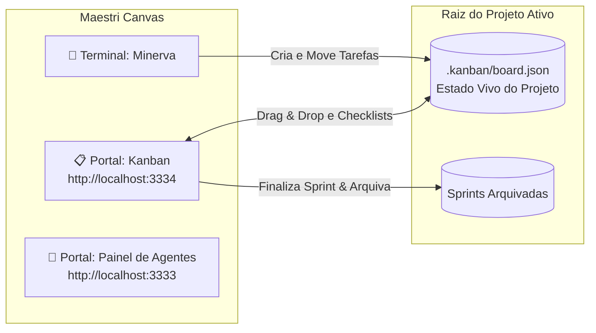

# 📋 Kanban para Maestri (`kanban-agents`)

> **Quadro Ágil Nativo, Leve e Isolado por Projeto para o Maestri Spatial Development Workspace.**  
> Zero Docker, Zero Configuração de Banco de Dados, Zero Burocracia de Login.

---

## 🌟 O que é?

O **Kanban para Maestri** é um gestor de tarefas visual estilo Trello projetado para operar perfeitamente como um portal dentro do **Maestri Canvas** ou no navegador.

Diferente de ferramentas pesadas que exigem contêineres Docker (como kan.bn ou Taiga), ele roda através de um servidor nativo ultraleve em Python (< 20 MB de RAM), salvando o estado de forma atômica e versionável diretamente no arquivo `.kanban/board.json` na raiz do seu projeto ativo.



---

## 🚀 Principais Recursos

1. **🏁 Ciclos de Sprint & Arquivamento Automático:**
   * Botão **Finalizar Sprint & Arquivar**: move automaticamente as tarefas concluídas para o histórico permanente de sprints arquivadas.
   * **Limpeza da coluna Concluído**: seu quadro ativo fica limpo e focado na próxima demanda.
   * Aba dedicada **📦 Sprints Arquivadas** para auditar ciclos anteriores a qualquer momento.

2. **⚡ Zero Docker & Zero Login:**
   * Não precisa do Docker Desktop aberto nem de PostgreSQL.
   * Inicialização instantânea em milissegundos.

3. **🖱️ Drag & Drop Fluido com Anti-Flicker:**
   * Arraste cartões livremente entre as colunas (**Backlog**, **A Fazer**, **Em Progresso**, **Revisão**, **Concluído**).
   * Diffing inteligente de JSON: o scroll e o estado do DOM não resetam enquanto você navega.

4. **✅ Checklists Interativos nos Cartões:**
   * Marque e desmarque subitens de entrega diretamente na face do cartão.
   * Barra de progresso visual com cálculo automático de porcentagem concluída.

5. **🔌 Regra Anti-Colisão de Portas:**
   * Opera por padrão na porta **`3334`**.
   * Se a porta estiver em uso por processo externo, salta automaticamente para `3335`, `3336`... e registra a porta ativa em `.maestri/ports.json`.

---

## 🛠️ Como Iniciar

### Modo Normal (Terminal):
```bash
python kanban.py
```
ou clicando duas vezes em `iniciar-kanban.bat`.

### Modo Silencioso (Segundo Plano no Windows):
```bash
wscript iniciar-silencioso.vbs
```

### Abrindo no Maestri Canvas:
No terminal do Maestri ou da Minerva:
```bash
maestri portal create http://localhost:3334 "Kanban"
```

---

## 📡 Endpoints da API REST

| Método | Endpoint | Descrição |
|---|---|---|
| `GET` | `/` ou `/index.html` | Interface visual do quadro |
| `GET` | `/health` | Status de saúde do serviço |
| `GET` | `/api/kanban` | Retorna o JSON do quadro ativo (`.kanban/board.json`) |
| `POST` | `/api/kanban` | Grava atomicamente alterações no quadro ativo |
| `POST` | `/api/kanban/arquivar` | Arquiva tarefas concluídas e avança o contador de sprint |
| `GET` | `/api/kanban/sprints` | Retorna o histórico de todas as sprints arquivadas |

---

## 📄 Licença

Distribuído sob a licença MIT. Parte do ecossistema de produtividade **Minerva & Maestri**.
